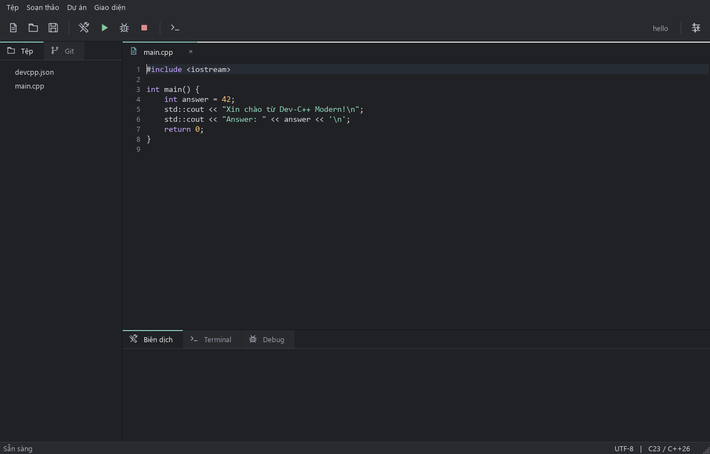

# Dev-C++ Modern

**ilcde's Dev-C++ fork for Fedora Workstation 44 and Windows 11.**

[](https://github.com/ilcde/Dev-Cpp-linux/actions/workflows/modern.yml)
[](LICENSE)

This is a fork of **[Embarcadero/Dev-Cpp](https://github.com/Embarcadero/Dev-Cpp)**, which builds on Orwell Dev-C++ and Bloodshed Dev-C++. The original Delphi/VCL source is preserved in `Source/`. The new desktop app lives in `modern/` and uses Qt 6 with Python bindings so it can run natively on Linux and Windows.

The goal is a practical C/C++ IDE with Vietnamese support, current compilers, an integrated terminal and Git, without a browser-based interface. This is an independent community fork, not an official Embarcadero release.



## Download

Get the platform-specific archive from **[Releases](https://github.com/ilcde/Dev-Cpp-linux/releases)**.

| Platform | Archive | Start here |
| --- | --- | --- |
| Windows 11 x64 | `DevCppModern-0.2.0-windows-x86_64.zip` | Extract everything, open `DevCppModern.exe` |
| Fedora Workstation 44 x64 | `DevCppModern-0.2.0-fedora44-x86_64.tar.gz` | Extract, run `./DevCppModern/devcpp-modern` |

The app bundles Python and Qt. **GCC/G++, GDB, Git and CMake are external tools**; install them using the [Windows](docs/INSTALL_WINDOWS.md) or [Fedora](docs/INSTALL_FEDORA.md) guide. Keep `_internal/` alongside the executable. SHA256 files are included with releases.

## What is included

- Vietnamese UI by default, with an English option.
- Compact native UI, original line icons, editor tabs, syntax highlighting and line numbers.
- **C23 and C++26** as the defaults for new projects. C++23 and older dialects remain selectable.
- Multi-file C/C++ builds, custom include/library paths, linker flags and CMake projects.
- Embedded PTY/ConPTY terminals with multiple tabs and ANSI colors.
- Git status, staged/unstaged diff, stage, unstage and commit.
- GDB debugging: breakpoints, stepping, local variables, call stacks and expression evaluation.
- Background colors, image/video wallpapers and optional Discord Rich Presence.
- UTF-8 files, Vietnamese filenames in the editor, atomic saves and unsaved-change prompts.

Selecting a language standard does not make a compiler implement every feature. GCC's C++26 support is still experimental; C++29 is a development option requiring a suitable GCC 17 snapshot. See [language and toolchain support](docs/PROJECTS.md#language-standards). The release does not claim complete C++26 library support.

## Quick start from source

Use Python 3.11 or newer. On Fedora, install the [system dependencies](docs/INSTALL_FEDORA.md) first.

```sh
git clone https://github.com/ilcde/Dev-Cpp-linux.git
cd Dev-Cpp-linux
python3 -m venv .venv
.venv/bin/python -m pip install -e './modern[test]'
.venv/bin/devcpp-modern modern/examples/hello
```

On Windows, use `py -3` instead of `python3`, and `.venv\Scripts\python.exe` / `.venv\Scripts\devcpp-modern.exe` instead of `.venv/bin/...`.

## Documentation

- [Fedora 44 installation and desktop integration](docs/INSTALL_FEDORA.md)
- [Windows 11 installation and compiler setup](docs/INSTALL_WINDOWS.md)
- [Using the editor, terminal, Git and debugger](docs/USER_GUIDE.md)
- [Project settings, C23/C++26, libraries and CMake](docs/PROJECTS.md)
- [Architecture, tests and release packaging](docs/DEVELOPMENT.md)
- [Troubleshooting and current limitations](docs/TROUBLESHOOTING.md)
- [Release history](docs/CHANGELOG.md)
- [Upstream attribution and third-party components](docs/ATTRIBUTION.md)
- [Original upstream README](docs/UPSTREAM_README.md)

## Status

Version **0.2.0 is an early development release**. The Qt app is a separate implementation; it does not yet import legacy `.dev` projects or replace every feature of the VCL IDE. There is no clangd completion, integrated debugger stdin, or GUI package installer yet. Existing C/C++ sources can be opened as a folder and configured with `devcpp.json` or CMake.

CI builds and tests on Windows and in a **Fedora 44 container**, including real GCC/GDB/Git/terminal integration tests and packaged-app startup under X11 and headless Wayland. Check the linked workflow for the result associated with each release commit. These checks cannot guarantee every GPU, multimedia codec or Discord installation behaves identically.

## Credits and license

Thanks to the Bloodshed, Orwell and Embarcadero Dev-C++ authors and contributors. Their code and copyright notices remain in this repository. The Qt workbench and its original icons are distributed under **GPL-2.0-or-later**, consistent with the upstream project. Dependencies retain their own licenses; see [attribution](docs/ATTRIBUTION.md) and [LICENSE](LICENSE).
